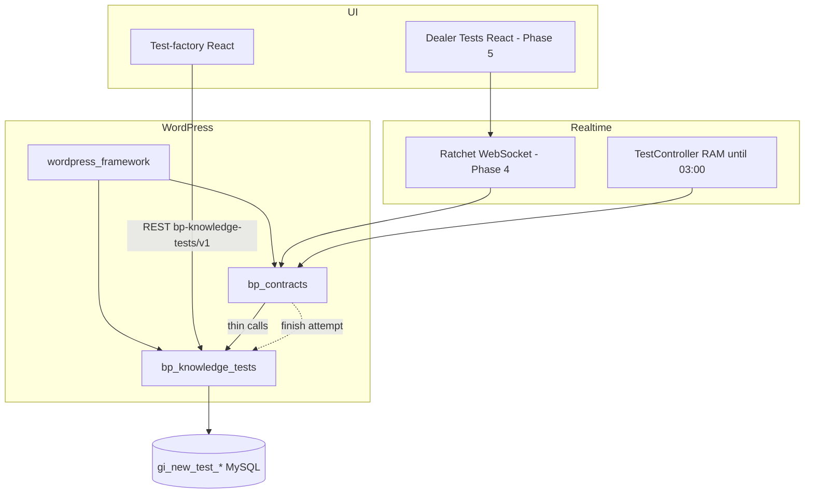

# Component Context: bp_knowledge_tests

## 1. Purpose

Dealers take **knowledge tests** in the personal account: multi-select questions, weighted scoring, bronze/silver/gold medals, temporary study materials after failures, retake rules, and admin-managed test content.

This WordPress plugin owns **business rules and persistence** (`gi_new_test_*`). The personal account shell, WebSocket transport, in-memory sessions, and (later) dealer-facing React UI live in **`bp_contracts`**.

| Concern | Owner |
|---------|--------|
| Tests, questions, answer options, scoring, attempts, achievements, materials, notifications (data), validity, critical update | **`bp_knowledge_tests`** |
| Tests menu, live session (RAM), WS commands, dealer UI, chat stars | **`bp_contracts`** (Phases 4–5) |
| Test-factory admin UI (§15–18) | **React in this plugin** → [assets/admin/](./assets/PROJECT_CONTEXT.md) |

**Delivery status:** Phases **1–4** complete. Dealer flow over WS: [WS protocol](./spec/WS_PROTOCOL.md), [`KnowledgeTestsWsWorker`](../bp_contracts/src/Workers/KnowledgeTestsWsWorker.php), [`TestController`](../bp_contracts/src/Testing/TestController.php). **Next:** Phase **5** dealer React; run Phase **4** staging QA on staging before dealer release ([PHASE_4_TASKS.md](./spec/PHASE_4_TASKS.md) Wave F).

**Parent:** [Site PROJECT_CONTEXT.md](../../../PROJECT_CONTEXT.md)  
**Shell integration:** [bp_contracts/PROJECT_CONTEXT.md](../bp_contracts/PROJECT_CONTEXT.md)

## Child directories

| Directory | Context |
|-----------|---------|
| [src/](./src/PROJECT_CONTEXT.md) | PHP application (bootstrap, domain, services, infrastructure) |
| [admin/](./admin/PROJECT_CONTEXT.md) | Test-factory React (source) |
| [assets/](./assets/PROJECT_CONTEXT.md) | Built JS/CSS enqueued by WordPress |
| [migrations/](./migrations/PROJECT_CONTEXT.md) | DDL baseline and schema versioning |
| [tests/](./tests/PROJECT_CONTEXT.md) | CLI domain/integration runners |
| [spec/](./spec/PROJECT_CONTEXT.md) | Product spec and implementation plans |

Each parent `PROJECT_CONTEXT.md` lists **only immediate subdirectories** that have their own `PROJECT_CONTEXT.md`; follow those links to drill down (for example [src/](./src/PROJECT_CONTEXT.md) → [Domain/](./src/Domain/PROJECT_CONTEXT.md) → [Record/](./src/Domain/Record/PROJECT_CONTEXT.md)).

---

## 2. How to read documentation

| Layer | Document | Use when |
|-------|----------|----------|
| **Product** | [Testing System — Project Documentation.md](./spec/Testing%20System%20%E2%80%94%20Project%20Documentation.md) | What the business wants (§1 baseline; §2+ agreed rules) |
| **Engineering plan** | [IMPLEMENTATION_PLAN.md](./spec/IMPLEMENTATION_PLAN.md) | Phases, DB columns §5.0, QA checklist |
| **WS protocol** | [WS_PROTOCOL.md](./spec/WS_PROTOCOL.md) | Locked titles + JSON (Phase 4) |
| **This plugin (code)** | Nested `PROJECT_CONTEXT.md` under each folder | How the repo implements the plan |
| **Tasks** | [PHASE_*_TASKS.md](./spec/PROJECT_CONTEXT.md) | Wave checklists per phase |

**Rule:** Do not silently rewrite product spec §1. Code changes that affect behavior → update the **lowest** relevant `PROJECT_CONTEXT.md` and [CHANGELOG.md](../../../CHANGELOG.md) when significant.

---

## 3. System context



**Hard boundary:** `bp_contracts` must **not** implement scoring, pass/fail, validity, or achievement rules — only session state and presentation ([IMPLEMENTATION_PLAN §4.2](./spec/IMPLEMENTATION_PLAN.md#42-layering-spec-25)).

---

## 4. Architecture inside the plugin

```text
index.php
    → PluginBootstrap (activate / plugins_loaded)
        → compose() → Plugin
            → boot() → AdminRestApi, AdminAppMount, AdminCatalogMenu

Plugin facades:
    catalog()   — test factory CRUD + config
    domain()    — scoring, thresholds, selection grading, classifier
    attempts()  — finish, materials, retake, validity, critical update, notifications
    reporting() — admin results + analytics (read-only)
```

Layering ([src/PROJECT_CONTEXT.md](./src/PROJECT_CONTEXT.md)):

```text
Infrastructure (HTTP, Admin, Repository, Schema)
        ↑
Services (use cases)
        ↑
Domain (pure rules + Record DTOs)
```

All SQL goes through **`DBWorker`** from `wordpress_framework` / `bp_contracts` with logical table keys (`KnowledgeTests`, `KnowledgeTestAnswers`, …) mapped to `gi_new_test_*` ([Repository context](./src/Infrastructure/Repository/PROJECT_CONTEXT.md)).

---

## 5. User identity

- **Business key:** `user_id` = `gi_new_users.id_user` (not raw `wp_users.ID` alone).
- Admin REST uses WordPress login + capability; dealer WS uses `gi_new_users.id_user` via `InteractionInterface::knowledgeTestsUserId()` (same as other `bp_contracts` WS).

---

## 6. State model (dealer-facing)

| State | Stored where | Notes |
|-------|----------------|-------|
| Not started | Derived | No completed attempt, no RAM session |
| In progress | **RAM** (`TestController`, Phase 4) | Lost at **03:00** server restart |
| Failed / Passed / Outdated | **`gi_new_test_attempts`** | Only **completed** attempts |
| Pending materials | **`gi_new_test_finished_attempts_explanations`** | Until user confirms “Examined” |
| Current medal | **`gi_new_test_user_achievements`** | **Latest** result, not historical best (§2.11) |

Retake requires configured delay **and** (if failed) materials examined **and** not locked at lock threshold **and** notification policy ([Attempt services](./src/Services/Attempt/PROJECT_CONTEXT.md)).

---

## 7. Scoring (summary)

Canonical spec: [§2.1 / §2.1.1](./spec/Testing%20System%20%E2%80%94%20Project%20Documentation.md#21-scoring).

```text
Maximum Correct Answers = sum of correct options (gi_new_test_answers.is_correct) per test

Net = valid_answers − invalid_answers   (counts of selected options, whole test)

Score = max(0, min(100, 100 × Net / Maximum Correct Answers))
```

- Unselected correct options do **not** add to `invalid_answers`.
- Per-question UI % may differ; **official** score is one calculation at finish.
- Implementation: [Domain](./src/Domain/PROJECT_CONTEXT.md) + `CompleteAttempt::finish`.

---

## 8. Database (index)

Full columns: [IMPLEMENTATION_PLAN §5.0](./spec/IMPLEMENTATION_PLAN.md#50-table-index). DDL: [migrations/](./migrations/PROJECT_CONTEXT.md). Schema option: **`bp_knowledge_tests_schema_version`** (target **3**).

| Table | Role |
|-------|------|
| `gi_new_tests` | Logical test + `version`, `achievement_area` |
| `gi_new_test_questions` | Question, explanation, reference |
| `gi_new_test_answers` | Answer **options** + `is_correct` |
| `gi_new_test_attempts` | Completed attempts only |
| `gi_new_test_attempt_questions` | Per-question right/failed counts |
| `gi_new_test_finished_attempts_explanations` | Temporary materials rows |
| `gi_new_test_achievements` / `gi_new_test_user_achievements` | Medal definitions + current user medal |
| `gi_new_test_notifications` | Dismiss counts per user/test/type |
| `gi_new_test_config` | Thresholds, retake, notification modes, rank display names |

---

## 9. Runtime entry

| Step | Location |
|------|----------|
| Plugin header + hooks | [index.php](./index.php) |
| Cross-plugin runtime (`bp_contracts` WS) | `bp_knowledge_tests_plugin()` in [index.php](./index.php) |
| Requires active `wordpress_framework` (`$servicesContainer`) | `bp_knowledge_tests_boot()` / activate |
| Schema migrate + seed | `PluginBootstrap::installSchemaIfNeeded()` |
| Capabilities on `init` | `CatalogCapability::registerCaps` |
| REST + admin UI | `Plugin::boot()` |

If framework is missing: admin notice only; plugin does not boot.

---

## 10. Admin today (Phase 3)

1. Factory user opens WP **Knowledge Tests** or page with `[knowledge_tests_admin]`.
2. `AdminAppAssets` loads `assets/admin/app.js`; `bpKnowledgeTestsAdmin` provides `restUrl`, `restNonce`, optional `adminUrls`.
3. React app calls **`/wp-json/bp-knowledge-tests/v1`** ([HTTP context](./src/Infrastructure/Http/PROJECT_CONTEXT.md)).
4. Handlers delegate to `catalog()`, `attempts()->criticalUpdate`, `reporting()` — no business logic in route classes.

**Build:** `cd admin && npm run build` → [admin/](./admin/PROJECT_CONTEXT.md).

**Auth:** `bp_manage_knowledge_tests_catalog` (or `manage_options` / filter `bp_knowledge_tests_can_manage_catalog`).

---

## 11. Dealer flow (planned)

| Phase | Capability |
|-------|------------|
| **4** | WS: list tests, start/resume RAM session, submit question, finish → `attempts()->complete->finish` |
| **5** | React: Tests list, one-question UI, materials page, stars |
| **6** | Notification popup / block / bottom bar from config |

Finish payload contract (already implemented server-side):

```php
// One line per catalog question for the test
['questionId' => int, 'rightAnswers' => int, 'failedAnswers' => int]
```

Phase 4 `TestController` accumulates counts in RAM using `domain()->selection->grade()` per question.

---

## 12. Development & verification

| Action | Command / path |
|--------|----------------|
| Domain tests (no WP) | `php tests/run_*.php` from plugin root — [tests/PROJECT_CONTEXT.md](./tests/PROJECT_CONTEXT.md) |
| Autoload namespace | `BpKnowledgeTests\` → `src/` ([composer.json](./composer.json)) |
| Composer / site autoload | `index.php` loads `public/vendor/autoload.php` when present |

Mandatory automated coverage includes scoring, retake, validity, complete attempt (User Rules §8.3).

---

## 13. Open integration items

| ID | Topic | Status |
|----|--------|--------|
| D1 | WS command names | **Resolved** — [spec/WS_PROTOCOL.md](./spec/WS_PROTOCOL.md) |
| D2 | Dealer roles for Tests menu | TBD Phase 4–5 |
| D10 | Notification row shape | `notification_type` per user/test — confirm in use |

Update this table when decisions land; details stay in [IMPLEMENTATION_PLAN §14](./spec/IMPLEMENTATION_PLAN.md#14-open-decisions-track-here).
